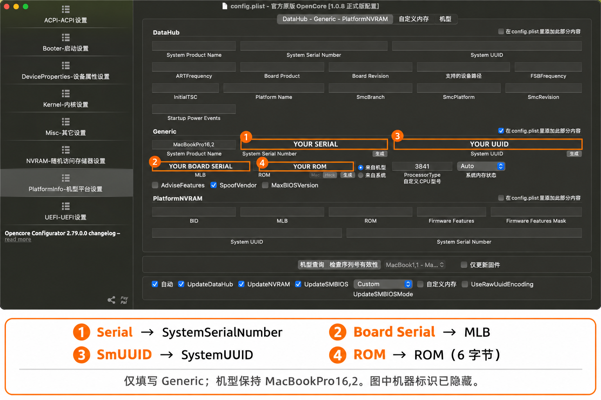

# Alienware x14 R1 — macOS Tahoe 26.7.3

OpenCore EFI for Alienware x14 R1 running macOS Tahoe 26.7.3.

本仓库提供 Alienware x14 R1 的 `EFI/OC` 配置及蓝牙系统卷修复工具。

## 当前系统信息与硬件型号

| 项目 | 当前配置 |
| --- | --- |
| 电脑型号 | Alienware x14 R1 |
| 处理器 | Intel Core i7-12700H（第 12 代） |
| 内存 | 16 GB |
| 独立显卡 | NVIDIA GeForce RTX 3050 Laptop GPU，4 GB 显存 |
| 无线网卡 / 蓝牙 | Intel Wi-Fi 6E AX211 / Intel 蓝牙 |
| 操作系统 | macOS Tahoe 26.7.3（25G342） |
| OpenCore | 1.0.9 DEBUG（`DBG-109-2026-11-08`） |
| SMBIOS | `MacBookPro16,2` |

以上为本机配置；`MacBookPro16,2` 是 OpenCore 使用的 SMBIOS 标识，实际硬件型号为 Alienware x14 R1。

## 系统安装前提

本配置基于通过 [NullMoth 1401](https://github.com/nullmoth/1401) 安装的 macOS Tahoe 26 环境。1401 的 Windows 工具负责检测硬件、生成 OpenCore 引导配置并制作 macOS 安装 U 盘；从 U 盘启动后，按上游文档完成 BIOS 设置与 macOS 安装，安装过程中所需的系统内容从 Apple 下载。

进入 macOS 后，使用 **1401 Mac 应用**安装 [NullMoth NVIDIA Driver for macOS](https://github.com/nullmoth/nvidia-macos-driver)。应用会识别实际用于启动的 OpenCore 分区，备份并调整相关配置，同时安装显卡驱动。安装及重启期间应保持该启动介质连接；1401 不会自动将 U 盘中的 OpenCore 迁移到内置硬盘。

**完成系统与 NVIDIA 驱动安装，并重启确认正常进入桌面后，再应用本仓库的 OC 配置与蓝牙修复。** NVIDIA 驱动安装在 macOS 系统中，并非仅靠复制 `EFI/OC` 即可部署；不要将其系统扩展重复放入 `EFI/OC/Kexts` 注入。安装环境与驱动运行环境的引导配置存在差异，因此本仓库的配置用于安装后的调整，不应直接替代 1401 生成的安装 U 盘配置。

安装与驱动部署请以对应版本的上游说明为准：

- [1401 项目与安装说明](https://github.com/nullmoth/1401#using-it) · [Windows 工具下载](https://github.com/nullmoth/1401/releases)
- [NVIDIA 驱动与 1401 Mac 应用说明](https://github.com/nullmoth/nvidia-macos-driver#1401-mac-app-recommended) · [Mac 应用与驱动下载](https://github.com/nullmoth/nvidia-macos-driver/releases)

调整 OC 前，请备份现有 EFI，并按下方的[OC 配置与机器标识](#oc-配置与机器标识)填写自己的机器标识。本仓库验证环境为 **macOS 26.7.3（25G342）**，蓝牙修复脚本仅支持该构建版本。

## 当前状态

以下依据本机当前驱动加载情况、系统报告及已完成的功能测试整理（2026-11-15）。驱动已加载不代表全部功能均已验证。

状态说明：✅ 已列功能完全正常；⚠️ 部分正常或仅部分功能已确认；❌ 当前配置下不支持；待验证表示证据不足，不能判定为正常或不支持。状态仅针对本机及表中列出的功能范围。

| 项目 | 状态 | 当前情况 | 驱动 / 验证依据 |
| --- | --- | --- | --- |
| CPU 识别与拓扑 | ⚠️ | 已识别 i7-12700H，系统报告 20 个逻辑处理器 | CpuTopologyRebuild 2.0.2 已加载；系统报告的物理核心数受拓扑处理影响，不作为实际核心规格 |
| CPU 电源管理 / 睿频 | ⚠️ | 短时采样确认频率随负载变化并出现睿频；多线程阶段存在功耗 / 温度限制 | 40 秒 powermetrics 采样：单线程阶段逻辑 CPU 报告频率最高约 3.63 GHz；多线程阶段包功耗估算约 44–45 W，出现 PL2_PL3 / THERMAL 限制。混合架构及拓扑伪装下读数仅作参考，未验证最高 4.7 GHz、深度节能及长期性能 |
| Intel Xe 核显 | 待验证 | WhateverXe 已加载，核显硬件加速尚未确认 | WhateverXe 0.8.2；当前显示设备与加速器报告仅见 NVIDIA，不能据此认定 Xe 加速可用 |
| NVIDIA 独显 | ⚠️ | RTX 3050 Laptop 已识别，NVAccel 加速器已激活 | NullMoth NVRM / NVAccel / NVRMFB / NVRMAGDC 3.0 已加载；系统报告支持 Metal，应用兼容性未全面测试 |
| 内屏 / 外接显示器 | ✅ | 当前双屏在线 | 内屏 1920 × 1080 @ 144 Hz；外接屏 2560 × 1440 @ 144 Hz |
| Wi-Fi | ✅ | 测速正常，2.4 GHz / 5 GHz 测试正常 | ForbiddenItlwm 0.5.4-beta.2 |
| 蓝牙 | ✅ | 可正常连接 AirPods、蓝牙键盘和鼠标 | IntelBluetoothFirmware 2.5.3、BlueToolFixup 2.7.2、BTLEAdvFixup 0.9.1；已完成系统卷去压缩修复 |
| AirDrop | ✅ | 手机 → 电脑、电脑 → 手机传输均已实测成功 | ForbiddenItlwm、BTLEAdvFixup 与 AWDL 参数配置 |
| 内置音频 | ✅ | 内建音频播放与录音均已实测验证 | AppleALC 1.9.8、SimpleHDA 1.0.1 已加载 |
| 摄像头 | ✅ | 已实测验证可用 | 本机功能测试确认 |
| HDMI / DP 音频 | ✅ | 已测试的显示连接音频输出正常，不包含雷电扩展坞链路 | NullMoth 音频设备；用户已确认播放正常 |
| 键盘 / 触控板 | ✅ | 键盘快捷键、触控板手势已实测验证；亮度调节状态见下项 | VoodooPS2Keyboard、VoodooI2C、VoodooI2CHID、VoodooInput |
| 亮度调节 | ❌ | 当前控制中心亮度滑块灰显，无法通过该控件调节 | BrightnessKeys 1.0.4 已加载，但尚未实现可用的系统亮度调节；内屏背光及快捷键调节仍需排查 |
| 电池与充电信息 | ✅ | 可读取电量、循环次数及充电状态 | SMCBatteryManager；电池健康状态另有“检查电池”提示，不属于驱动正常与否的判断依据 |
| NVMe 存储 | ✅ | Samsung PM9A1 1 TB 已识别，TRIM 已启用，SMART 已验证 | Apple IONVMeFamily、NVMeFix 1.1.4 |
| USB-A / Hub / 键鼠 | ✅ | A 口连接 USB Hub、键盘和鼠标已确认正常使用 | IORegistry 可见 Genesys Hub 及已绑定的 USB HID 键盘、鼠标；仅代表当前连接组合 |
| USB-C / 移动硬盘盒 | ⚠️ | 可识别 RTL9210B USB 硬盘盒及 128 GB 外置磁盘，但读取测试发生异常掉盘 | 512 MiB 只读测试等待约 38 秒后返回 Device not configured，实际读取 0 字节；已确认期间无主动拔插，稳定性尚未通过 |
| Thunderbolt / USB4 | ⚠️ | 本次连接雷电扩展坞后，其 HDMI 接口无视频输出；雷电完整功能未验证通过 | 系统信息未报告雷电硬件；该次测试不能单独确定故障位于雷电、视频隧道或扩展坞兼容性。USB 设备可用不代表雷电功能正常 |
| USB 端口完整性 | ⚠️ | 各 USB 接口均已确认可识别设备；稳定性尚未全部验证 | 用户确认端口识别情况；当前使用 USBToolBox / UTBDefault。Type-C 正反插、各端口速率及睡眠后重连未完整测试，移动硬盘掉盘问题另见上项 |
| 合盖 / 睡眠 / 唤醒 | ⚠️ | 合盖熄屏、开盖亮屏已确认；系统睡眠及睡眠后的唤醒未验证 | 屏幕开关行为已实测，不代表系统已进入睡眠或完成睡眠唤醒验证 |

## OC 配置与机器标识

- `PlatformInfo → Generic` 的 `SystemSerialNumber`、`MLB`、`SystemUUID` 已清空，`ROM` 已置零。请为自己的机器生成并填写，不能直接沿用他人的标识。
- 本仓库只包含 `EFI/OC`，不是完整启动盘；现有 EFI 还需匹配的 `EFI/BOOT/BOOTx64.efi`。先备份自己的 EFI，保留其他系统的启动目录。
- ACPI、USB、图形及其他硬件配置针对本机。同型号的不同硬件配置也应单独检查；不将未实测的功能标为正常。

### 填写自己的机器标识

打开 `EFI/OC/config.plist`，进入 **PlatformInfo → Generic**，填写图中标出的四个字段。`SystemProductName` 保持为 **`MacBookPro16,2`**。

推荐使用 [GenSMBIOS（GitHub）](https://github.com/corpnewt/GenSMBIOS) 为自己的电脑生成一套标识；这只是其中一种方式，工具的具体操作请参考其项目说明。



| 图中编号 | Generic 字段 | 填入的内容 |
| --- | --- | --- |
| ① | `SystemSerialNumber` | 生成结果中的 `Serial`，整机序列号 |
| ② | `MLB` | 生成结果中的 `Board Serial`，主板序列号 |
| ③ | `SystemUUID` | 生成结果中的 `SmUUID` |
| ④ | `ROM` | 生成结果中的 `Apple ROM` 或 `Random ROM`，6 字节、12 位十六进制值 |

**MLB 就是 Board Serial**，不需要在配置工具里寻找单独的 MLB 生成按钮。`ROM` 在 plist 中应保持 **Data** 类型，不能填成普通字符串，也不能保留全零值。

本配置已启用 `PlatformInfo → Automatic`，在 **Generic** 中填写即可，不必重复填写下方的 `PlatformNVRAM` 或上方的 `DataHub`。保存后重新打开配置，确认四项均已填写且机型未变。

图片已隐藏原机器标识，`YOUR SERIAL` 等文字仅为占位提示，不能作为实际配置值。截图中的编辑器版本标题仅用于展示字段位置，不代表本仓库的 OpenCore 版本；本仓库使用的是 **1.0.9 DEBUG**。

每台电脑使用自己的标识，配置完成后保持固定。已有正常使用的 iCloud / iMessage 标识时，可沿用自己原来的整套值。填写后的配置请保留在本地，不要提交到公开仓库。更多说明可参考 [Dortania：iServices 配置](https://dortania.github.io/OpenCore-Post-Install/universal/iservices.html)。


## 已修复问题

### 蓝牙系统卷修复

BlueToolFixup 的内存补丁与 `bluetoothd` 的 APFS 压缩页面校验发生冲突，引起 `SIGBUS / KERN_MEMORY_ERROR`。本机已用原始字节和补丁字节精确复现内核日志中的两组哈希。

脚本把目标电脑自己的 `/usr/sbin/bluetoothd` 以未压缩形式重新存储，保持原始程序内容、苹果签名和权限，创建未封印启动快照，并保留原快照供回退。**仅复制 OC 不包含此修复。** 本机修复后蓝牙已恢复，其他电脑仍需实测。

需要 Python 3.9+、Intel macOS **25G342**、已关闭 Authenticated Root 与 SIP 文件系统保护，且实际启动 OC 的 `SecureBootModel` 为 `Disabled`。脚本会检查条件，不会自动修改安全设置或重启。先备份重要数据，关闭其他系统更新及补丁工具。

```sh
python3 scripts/bt_uncompress.py check
sudo python3 scripts/bt_uncompress.py apply --yes
# 保存工作、手动重启后验证
sudo python3 scripts/bt_uncompress.py verify
```

回退使用 `sudo python3 scripts/bt_uncompress.py rollback --yes`，再手动重启。回退选择整个修复前的系统卷快照；后续系统构建或快照已经变化、原快照丢失时会拒绝自动回退。脚本不捆绑苹果系统程序或本机 UUID，已有未压缩文件会跳过重复修复。

系统更新或重装后需重新检查。工具只支持已验证的 25G342，不能把旧版系统程序用于新系统。按驱动项目的要求，macOS 更新前先移除 `-btleadv` 并重启一次。

### AirDrop 修复

| 组件 | 版本 |
| --- | --- |
| Lilu | 1.7.3 |
| IntelBluetoothFirmware | 2.5.3 |
| BlueToolFixup | 2.7.2 |
| BTLEAdvFixup | 0.9.1 |
| ForbiddenItlwm | 0.5.4-beta.2 |

当前使用 ForbiddenItlwm 和 BTLEAdvFixup，并配置该版本要求的 AWDL 启动参数。仓库仅保留当前系统所需的 OC 文件，不包含 AirportItlwm、IntelBTPatcher 及不适用于当前内核的加载条目。**不要同时启用 IntelBTPatcher 与 BTLEAdvFixup。**

AirDrop 使用本仓库配置的 ForbiddenItlwm、BTLEAdvFixup 及对应 AWDL 启动参数，配合上述蓝牙系统卷修复。本机已实测手机与电脑之间双向文件传输成功；驱动仍为 beta，其他硬件配置与系统版本需另行确认。

## 参考项目与致谢

本配置及修复方案参考或使用了以下 GitHub 项目，感谢各项目作者的开发与维护。第三方组件版权及许可归各原作者，使用与分发请遵守对应项目的许可证。

| 项目 | 用途 |
| --- | --- |
| [NullMoth 1401](https://github.com/nullmoth/1401) | 硬件检测、OpenCore 配置生成与 macOS 安装 U 盘制作 |
| [NullMoth NVIDIA Driver for macOS](https://github.com/nullmoth/nvidia-macos-driver) | NVIDIA 显卡驱动及 1401 Mac 安装应用 |
| [OpenCorePkg](https://github.com/acidanthera/OpenCorePkg) | OpenCore 引导器及配置校验工具 |
| [Lilu](https://github.com/acidanthera/Lilu) | 内核与用户空间补丁框架 |
| [BrcmPatchRAM / BlueToolFixup](https://github.com/acidanthera/BrcmPatchRAM) | 蓝牙兼容性修复 |
| [IntelBluetoothFirmware](https://github.com/lshbluesky/IntelBluetoothFirmware) | Intel 蓝牙固件与相关驱动 |
| [ForbiddenItlwm / BTLEAdvFixup](https://github.com/retropineaple/ForbiddenItlwm) | Intel 无线网络、蓝牙广播及 AirDrop 支持；本配置使用 [v0.5.4-beta.2 发布包](https://github.com/retropineaple/ForbiddenItlwm/releases/tag/v0.5.4-beta.2) |
| [GenSMBIOS](https://github.com/corpnewt/GenSMBIOS) | 机器标识生成工具 |
